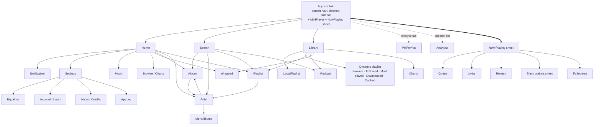
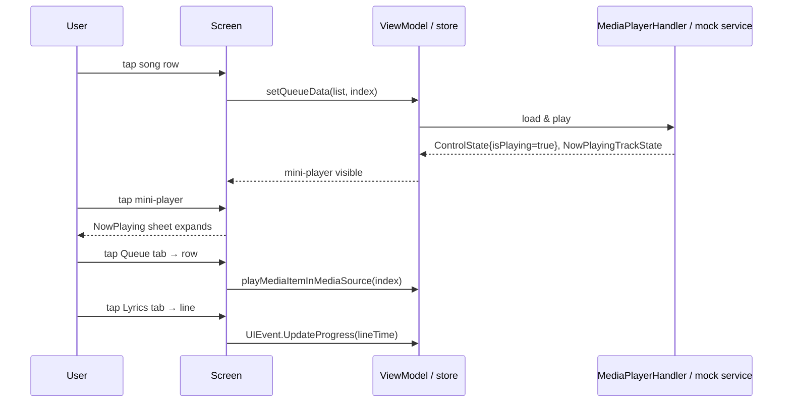
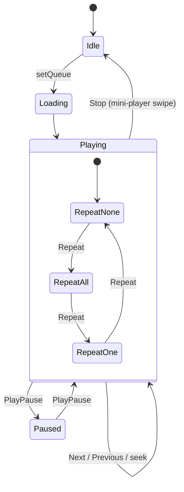
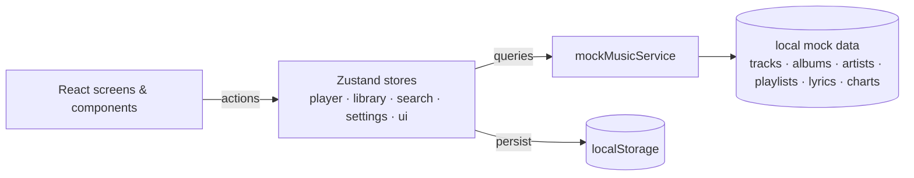

# 02 — UI & Interaction Map (SimpMusic `dev@f78a4fd`)

All entries below were derived from reading `composeApp/src/commonMain/kotlin/com/maxrave/simpmusic/ui/**` and `viewModel/**`. Items marked **(unverified)** could not be fully confirmed from source and are treated as such in the React build.

## A. Screen inventory

| # | Screen | Route / destination | Purpose | Header | Main content | Bottom nav | Floating | Sheets / dialogs | Loading | Empty | Error |
|---|---|---|---|---|---|---|---|---|---|---|---|
| 1 | Home | `HomeDestination` | Discovery landing | Greeting (good_morning/afternoon/evening/night), account avatar chip, notification bell, settings cog | Account/login promo, Quick picks (play_all), home shelves (`HomeItem` carousels), Chart (top songs/videos/artists per country), Mood & moments (commute, energize, feel_good, focus, party, relax, romance, sad, sleep, workout), Top artists, Wrapped entry card, Taste card | yes | — | Login warning dialog, Blog promo dialog, Review dialog | Shimmer rows | — | OfflineErrorState + retry |
| 2 | Mood | `MoodDestination(params)` | Mood/genre playlist list | Back, title | Grouped playlist sections | yes | — | — | shimmer | — | retry |
| 3 | Notification | `NotificationDestination` | New releases from followed artists | Back, title | Notification list (artist + release) | yes | — | — | spinner | "no notifications" | — |
| 4 | Settings | `SettingsDestination` | All preferences | Back, title | Sections: User interface, Content, Playback, Audio (EQ/effects), Lyrics, SponsorBlock, Storage, Backup, Database, Listening history, AI, Proxy, Spotify/Last.fm/Discord integrations, Login sync, Developer option, About | no | — | Many dialogs (quality, language, proxy, speed/pitch, custom color, equalizer, backup frequency, log out) | — | — | — |
| 5 | Analytics | `AnalyticsDestination` | Listening stats | Back | Charts (`AnalyticsCharts`), Listening receipt | optional tab | — | ShareImageSheet | spinner | "not enough data" | — |
| 6 | Wrapped | `WrappedDestination` | Yearly recap cards | Close | Paged cards (Opening, Minutes, Top tracks/artists/albums, Clock, Decades, Biggest day, Type, Share) | no | — | share | — | `WrappedNotEnoughDataScreen` | — |
| 7 | Listen Together / Settings | `ListenTogetherDestination`, `ListenTogetherSettingsDestination` | Shared session | Back | Session controls, peers | no | — | — | — | — | — |
| 8 | Search | `SearchDestination` | Search + history + suggestions | Search bar (back/clear), recognize_song mic (Android) | Recent searches (clear_search_history), suggestions, filter chips: all / songs / videos / albums / artists / playlists / podcasts, result lists | yes | — | Now‑playing sheet on long press | spinner | "no_results_found" / "everything_you_need" intro | error_occurred + retry |
| 9 | Library | `LibraryDestination` | Hub | Title "Your Library", chips | Chip sections: Your library (recently added, canvas songs), Wrapped tab, SimpMusic charts, YouTube playlists, Mix for you, Local playlists, Favorite playlists, Downloaded playlists, Favorite podcasts; quick tiles (Favorite, Followed, Most played, Downloaded, Cached) | yes | Create playlist | CreateSheet (new playlist), playlist sheet | spinner | per‑section "no_…" strings | — |
| 10 | Dynamic playlist | `LibraryDynamicPlaylistDestination(type)` | Favorite/Followed/MostPlayed/Downloaded/Cached/Top* lists | Back, title, sort | Track list / artist list | yes | play all | NowPlaying sheet | spinner | empty | — |
| 11 | Local playlist | `LocalPlaylistDestination(id)` | User playlist detail | Collapsing toolbar, more | Cover (editable), title, created_at, length, play/shuffle/download/sync, search, sort_by, suggest tracks, track list with drag reorder | yes | — | Playlist sheet (edit_title, edit_thumbnail, delete_playlist, sync, update_playlist), Image cropper, sort sheet | spinner | empty | — |
| 12 | Mix for you | `MixForYouDestination` | YT Music mixes | Title | Mix cards | optional tab | — | — | spinner | "no_mixes_found" | — |
| 13 | Album | `AlbumDestination(browseId)` | Album detail | Collapsing art, back, more | Title, artist, year_and_category, album_length, play/shuffle/download/like, description, track list, other_version | yes | — | Album sheet, NowPlaying sheet | shimmer | — | retry |
| 14 | Artist | `ArtistDestination(channelId)` | Artist detail | Collapsing banner, back | Follow/subscribe, radio/shuffle, popular, singles, albums (more), videos, featured_in, related_artists, liked_songs_by, description | yes | — | Artist sheet (share) | shimmer | — | retry |
| 15 | Playlist (YT) | `PlaylistDestination(id)` | Remote playlist | Collapsing art, more | Title, author, play/shuffle/download/like, track list, continuation | yes | — | Playlist sheet, NowPlaying sheet | shimmer | — | retry |
| 16 | Podcast | `PodcastDestination(id)` | Podcast episodes | Collapsing art | Episodes (`PodcastEpisodeItem`), favorite | yes | — | — | spinner | — | retry |
| 17 | Browse | `BrowseDestination(params)` | Generic YT browse page (charts country, "more") | Back | Shelves | yes | — | — | shimmer | — | retry |
| 18 | More albums | `MoreAlbumsDestination` | Artist full album/singles grid | Back | Grid | yes | — | — | spinner | — | — |
| 19 | Credit | `CreditDestination` | Licenses | Back | Library list | no | — | — | — | — | — |
| 20 | App log | `AppLogDestination` | Debug log | Back, share | Log text | no | — | — | — | — | — |
| 21 | Login (YouTube / Spotify / Last.fm / Discord) | `Login*Destination` | WebView/OAuth | Back | Web view, cookie capture | no | — | — | spinner | — | error |
| 22 | Now Playing | Sheet over scaffold (`NowPlayingScreen`) | Full player | Collapse chevron, playlist name / "now_playing_upper", more | 4 styles (Apple Music, M3 Expressive, SoundCloud, Spotify): artwork pager (canvas/video), title, artist, like, progress, transport, bottom tabs: lyrics / queue / related, song info (bitrate, codec, bpm, key), comments | — | — | NowPlaying sheet, Queue view, Lyrics view, Output sheet, Sleep timer, Speed/pitch, Lyrics provider, Comments | shimmer | lyrics "unavailable" | — |
| 23 | Fullscreen (video/lyrics) | `FullscreenDestination` | Landscape video + lyrics | Close | Video surface, FullscreenLyricsContent | — | — | — | — | — | — |
| 24 | Mini player | `MiniPlayer.kt` | Persistent bar above nav | — | Art, title, artist, like, play/pause, next, progress; swipe to dismiss; tap to expand | — | — | — | — | — | — |

## B. Button‑by‑button interaction map

| Screen | Element | Action | Original behavior (source) | State change | Destination |
|---|---|---|---|---|---|
| Home | Avatar chip | Tap | Opens account sheet / login (`log_in_to_`) | account state | Login |
| Home | Bell | Tap | `NotificationDestination` | — | Notification |
| Home | Cog | Tap | `SettingsDestination` | — | Settings |
| Home | Quick picks → play_all | Tap | `setQueueData` + play first | queue, nowPlaying | Player opens mini |
| Home | Song row | Tap | Play with shelf as queue | queue | — |
| Home | Song row | Long press | NowPlaying bottom sheet | sheet visible | — |
| Home | Album/playlist card | Tap | `AlbumDestination`/`PlaylistDestination` | — | Album/Playlist |
| Home | Artist card | Tap | `ArtistDestination` | — | Artist |
| Home | Chart country dropdown | Select | `HomeViewModel.exploreChart(code)` | chart state | — |
| Home | Mood card | Tap | `MoodDestination(params)` | — | Mood |
| Home | Shelf "more" | Tap | `BrowseDestination` | — | Browse |
| Home | Wrapped card | Tap | `WrappedDestination` | — | Wrapped |
| Search | Field | Type | Suggestions (`SearchViewModel.suggestQuery`) | suggestion state | — |
| Search | Submit | Enter | `searchAll`, save `SearchHistory` | results, history | — |
| Search | History row | Tap | Re‑run search | query | — |
| Search | Clear history | Tap | DB delete | history=[] | — |
| Search | Filter chip | Tap | `searchSongs/Videos/Albums/Artists/Playlists/Podcasts` | filter | — |
| Search | Mic | Tap | Song recognition (Android only) | recognizing | result row |
| Library | Chip | Tap | Switch `LibraryChipType` | chip | — |
| Library | Tile (Favorite/Followed/MostPlayed/Downloaded/Cached) | Tap | `LibraryDynamicPlaylistDestination(type)` | — | Dynamic playlist |
| Library | + Create | Tap | `CreateSheet` → `LocalPlaylistRepository.insert` | playlists | — |
| Library | Playlist card | Tap / long press | Open / playlist sheet | — | LocalPlaylist |
| LocalPlaylist | Play / Shuffle | Tap | set queue (+shuffle) | queue, isShuffle | — |
| LocalPlaylist | Download | Tap | `DownloadHandler` whole playlist | downloadState | — |
| LocalPlaylist | Sort | Tap | sort sheet (title/date added) | sort | — |
| LocalPlaylist | Search icon | Tap | filter within playlist | filter | — |
| LocalPlaylist | Suggest | Tap | YT suggestions for playlist | suggestions | — |
| LocalPlaylist | Track drag handle | Drag | `RememberDragDropState` reorder | order | — |
| LocalPlaylist | Row more | Tap | sheet w/ `remove_from_playlist` | playlist | — |
| LocalPlaylist | More | Tap | edit_title / edit_thumbnail / delete_playlist / sync | — | dialogs |
| Album | Play/Shuffle/Like/Download/Share | Tap | queue / like album / download / share url | states | — |
| Artist | Follow | Tap | subscribe (`sync_follow_to_youtube`) | followed | — |
| Artist | Radio / Shuffle | Tap | start radio queue | queue (isRadioQueue) | Player |
| Artist | Albums "more" | Tap | `MoreAlbumsDestination` | — | More albums |
| MiniPlayer | Body | Tap | expand NowPlaying sheet | sheet | Now Playing |
| MiniPlayer | Play/Pause / Next / Like | Tap | `UIEvent.PlayPause/Next/ToggleLike` | controllerState | — |
| MiniPlayer | Swipe down/left | Gesture | `UIEvent.Stop` → dismiss | nowPlaying=null | — |
| Player | Chevron | Tap | collapse | sheet | — |
| Player | More | Tap | NowPlaying sheet | sheet | — |
| Player | Artwork pager | Swipe | prev/next track (`ArtworkPagerLogic`) | index | — |
| Player | Heart | Tap | `UIEvent.ToggleLike` + HeartBurstEffect | isLiked | — |
| Player | Dislike (YT) | Tap | `dislike_on_youtube` | likeStatus | — |
| Player | Slider | Drag | `UIEvent.UpdateProgress` | timeline | — |
| Player | Shuffle | Tap | `UIEvent.Shuffle` | isShuffle | — |
| Player | Prev | Tap | `UIEvent.Previous` (restart if >3s) | index | — |
| Player | Play/Pause | Tap | `UIEvent.PlayPause` | isPlaying | — |
| Player | Next | Tap | `UIEvent.Next` | index | — |
| Player | Repeat | Tap | `UIEvent.Repeat` cycles None→All→One | repeatState | — |
| Player | Lyrics tab | Tap | show LyricsView | tab | — |
| Player | Queue tab | Tap | show queue | tab | — |
| Player | Related tab | Tap | related tracks | tab | — |
| Player | Output / Cast | Tap | AppleMusicOutputSheet / cast | cast | — |
| Player | Volume | Drag | `UIEvent.UpdateVolume` | volume | — |
| Player | Fullscreen (video) | Tap | `FullscreenDestination` | — | Fullscreen |
| Player | Song info | Tap | bitrate/codec/mime/itag/bpm/key | — | sheet |
| Player | Comments | Tap | `CommentsBottomSheet` | — | sheet |
| NowPlaying sheet | like / add_to_a_playlist / add_to_queue / play_next / start_radio / download / share / sleep_timer / playback_speed_pitch / main_lyrics_provider / youtube_url / album / artists / delete_from_queue / move_to_play_next | Tap | `NowPlayingBottomSheetUIEvent.*` | respective | — |
| Queue | Row | Tap | play index | index | — |
| Queue | Row drag | Drag | reorder (`move_up/move_down`) | queue | — |
| Queue | Row swipe/remove | Gesture | `delete_from_queue` | queue | — |
| Lyrics | Line | Tap | seek to line time | timeline | — |
| Lyrics | Provider | Tap | change provider (SimpMusic Lyrics / LRCLIB / Spotify / YouTube transcript) | lyrics | — |
| Lyrics | Offset | Tap | `LyricsOffsetControl` ±ms | offset | — |
| Lyrics | Share | Tap | `ShareLyricsSheet` select lines | — | sheet |
| Lyrics | Add lyrics | Tap | `AddLyricsSheet` | — | sheet |
| Settings | Each row | Tap/toggle | `SettingsViewModel.set*` → DataStore | setting | dialogs |
| Player | Comments | Tap | `CommentsBottomSheet` (`CommentsViewModel`): list, reply, like heart; input only when signed in (`comments_log_in_hint`); `comments_turned_off` / `comments_load_error` + retry | comments state | sheet |
| Fullscreen | Exit / Lyrics toggle (Subtitles/SubtitlesOff) / Replay5 / Forward5 / Play / Skip / Mute / PiP / Share lyrics / Info / More | Tap | `FullscreenPlayer.kt` + `FullscreenLyricsContent.kt`; auto‑hiding controls; "crossfading" badge | controls visibility, lyrics visible, volume | — |
| Any list | Long‑press row → Select | Gesture | `SongSelectionState` → `SongSelectionTopAppBar` ("n selected", select_all, exit_selection, max_selection_reached) + `SelectedSongsBottomSheet` (favorite, add_to_a_playlist, download, play_next) | selection set | — |

## C. User journeys

1. Launch → Home: `App.kt` scaffold, `HomeViewModel.getHomeItemList()`; shimmer → shelves; restored queue shows mini‑player (`save_playback_state`).
2. Home → Search → Results → Track: bottom nav Search → type → suggestions → submit → chips → tap row → `setQueueData` → mini‑player.
3. Track → Mini → Full: tapping mini expands `NowPlayingScreen` sheet (style from `now_playing_style` setting).
4. Player → Queue → Track: queue tab/view → tap row → `playMediaItemInMediaSource(index)`.
5. Player → Lyrics: lyrics tab → synced highlight by `timeline.current`; tap line seeks.
6. Home → Album → Artist: card → `AlbumDestination` → tap artist name → `ArtistDestination`.
7. Library → Playlist → Manage: Library chip Local playlists → `LocalPlaylistDestination` → more → edit/delete/sort/reorder/suggest.
8. Explore → Charts: Home chart section (country dropdown) or Library "SimpMusic charts" chip → play.
9. Search → Recognize: mic → Android recognition service → result (Android only; desktop shows unavailable).
10. Player → Audio settings: NowPlaying sheet → playback_speed_pitch; Settings → Audio → Equalizer (built‑in/system), 8D, reverb, normalize, crossfade.
11. Settings → Appearance: theme (light/dark/system), theme color (default/wallpaper/custom), now‑playing style, lyrics style, liquid glass, animated artwork.
12. Downloads → Offline: Library → Downloaded tile / Downloaded playlists → play offline.
13. Account → Backup: Settings → Backup → backup / restore / auto backup frequency / keep backups.
14. Additional: Wrapped journey; Analytics; Listen together; Login sync QR; Import playlists; Sleep timer; Notifications of new releases.

## D. State & event mapping

| State | Holder | Mutated by |
|---|---|---|
| `nowPlayingState`, `controllerState`, `timeline`, `nowPlayingScreenData` | `SharedViewModel` ← `MediaPlayerHandler` | `UIEvent.*` |
| `queueData` | `MediaPlayerHandler` | `setQueueData`, `addToQueue`, `playNext`, `removeFromQueue`, `moveItem` |
| search `query`, `suggestions`, `results`, `filter`, `history` | `SearchViewModel` | text input, chips |
| `selectedChip` (`LibraryChipType`), playlists, favorites | `LibraryViewModel` | chips, create sheet |
| Repeat/shuffle | `ControlState` | `UIEvent.Repeat/Shuffle` |
| Like | `ControlState.isLiked`, `likeStatus` | `ToggleLike` |
| Download | `DownloadState` per song | `Download` sheet event |
| Dialog/sheet visibility | local `remember` + `NowPlayingBottomSheetViewModel` | user taps |
| Settings | `SettingsViewModel` ← `DataStoreManager` | setting rows |
| Sleep timer | `sleepTimerState` | `SetSleepTimer` |

---

## Navigation & State‑Flow Diagrams

## Navigation hierarchy (original `AppNavigationGraph` → React Router)

## Key transitions

## Playback state flow

## UI → state → data (React rebuild)

---

## Screen State Inventory

| Screen | Loading | Empty | Error | Interactive states |
|---|---|---|---|---|
| Home | shimmer shelves (`Shimmer.kt`) | — (always has content when online) | `OfflineErrorState` + retry | greeting by hour; chart country; mood selection |
| Search | spinner under bar | intro ("everything_you_need"), `no_results_found` | `error_occurred` + `retry` | query, suggestions, filter chip, history, recognizing |
| Library | spinner | `no_playlists_added`, `no_favorite_playlists`, `no_playlists_downloaded`, `no_favorite_podcasts`, `no_charts_found` | — | chip, create sheet open |
| Dynamic playlist | spinner | empty text | — | sort order |
| Local playlist | spinner | empty list | — | editing title, cropping cover, sorting, dragging, filtering, suggesting, downloading |
| Album / Playlist / Artist / Podcast | shimmer header | — | retry | liked, downloaded, following, description expanded |
| Mood / Browse / MoreAlbums | shimmer | — | retry | — |
| Notification | spinner | no notifications | — | — |
| Settings | — | — | — | each pref; dialogs |
| Equalizer | — | — | — | enabled, preset, 10 bands, 8D, reverb |
| Analytics | spinner | not enough data | — | range |
| Wrapped | — | `WrappedNotEnoughDataScreen` | — | page index |
| Account | spinner | `no_account` / `guest` | — | logged in / out per provider |
| Mini player | — | hidden when no track | — | playing, liked, progress |
| Now playing | artwork shimmer | lyrics `unavailable` | — | playing, shuffle, repeat, liked, tab, slider dragging, volume, sleep timer active, speed |
| Queue | — | — | — | dragging, current index |
| Lyrics | spinner | not found → add lyrics | — | current line, provider, offset, font scale |
| Track sheet | — | — | — | per‑track liked / downloaded / in playlist |

Persisted (original DataStore/Room → React localStorage): settings, favorites, followed artists, local playlists, search history, play counts/history, queue + position (`save_playback_state`), shuffle/repeat (`save_shuffle_and_repeat_mode`), downloads.
